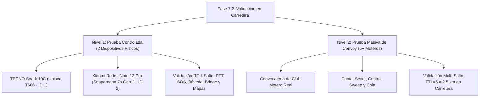

# FIELD_TEST_PROTOCOL — Protocolo Oficial de Prueba de Campo en Carretera (Fase 7.2)

**Versión:** 2.0 · Noviembre 2026  
**Aprobación:** Fase 7.2 (Validación Empírica en Carretera · Opción B)  
**Referencias Normativas:** `ROADMAP.md` (Fase 7.2), `DESIGN.md`, `RULES.md` (R10–R15), `BLE_MESH_ARCHITECTURE_HITO_0.md`, `GAMIFICATION.md` y `docs/MEMORY.md` (D78–D92).

---

## 1. Alcance y Estrategia de Dos Niveles (Opción B)

Para garantizar rigor metodológico sin bloquear el avance ante la disponibilidad inmediata de hardware, la Fase 7.2 se divide en dos fases operativas:



- **Nivel 1 (Inmediato):** Prueba de campo controlada en pareja real entre los 2 dispositivos físicos disponibles: **TECNO Spark 10C** (nodo de cierre/gama entrada) y **Xiaomi Redmi Note 13 Pro** (nodo punta/gama media-alta), cubriendo interoperabilidad cruzada de chipsets (Unisoc vs Qualcomm), radiofrecuencia en movimiento, PTT, SOS con ficha médica, puente repetidor celular y mapas offline.
- **Nivel 2 (Convocatoria de Club):** Protocolo integral congelado para el convoy de 5 o más moteros en formación escalonada de carretera abierta (50–100 km).

---

## 2. Nivel 1 — Protocolo de Prueba Controlada en Carretera (2 Dispositivos)

### 2.1 Asignación de Roles y Hardware
| Dispositivo | Chipset / SO | Rol en Rodada | ShortID | Identidad de Prueba | Ubicación en Marcha |
|---|---|---|---|---|---|
| **Xiaomi Redmi Note 13 Pro** | Snapdragon 7s Gen 2 · HyperOS | **Líder / Punta** | `0x0001` (ID 1) | Capitán Convoy (Líder de Club) | Soporte de Manillar (Cabina) |
| **TECNO Spark 10C** | Unisoc T606 · HiOS 8.6 | **Sweep / Cierre** | `0x0002` (ID 2) | Piloto de Apoyo (Sargento/Miembro) | Soporte o Bolsillo de Chaqueta |

---

### 2.2 Batería de 6 Pruebas Controladas (Nivel 1)

#### 🔹 Test A — Descubrimiento BLE, Heartbeats y PLR en Movimiento
- **Objetivo:** Verificar enlace mutuo continuo sin celular a velocidades entre 40 km/h y 80 km/h.
- **Condición:** Distancia entre motos de 15 a 50 metros. Modo avión activado en ambos teléfonos o zona de carretera rural.
- **Procedimiento:**
  1. En ambos terminales, ingresar a la pestaña **Rodadas** y presionar **"Iniciar Rodada (Cabina Activa)"**.
  2. Verificar que la notificación persistente del Foreground Service indique: `🏍️ Convoy Mesh: 2 pilotos enlazados (1 compañero(s) en radiofrecuencia)`.
  3. Rodar durante 15 minutos en tramo vial.
- **Criterio de Aprobación:**
  - Packet Loss Rate (PLR) direccional ≤ 5.0% a distancias ≤ 40 metros.
  - Ningún bloqueo de UI (0 ANR, 0 Fatal Exception).
  - Al separarse >100 m y volverse a juntar, reconexión automática en ≤ 6 segundos (histéresis de 2 heartbeats).

---

#### 🔹 Test B — Transmisión de Audio PTT (Opus + ChaCha20-Poly1305)
- **Objetivo:** Evaluar la claridad acústica del códec Opus (20 kbps), supresión de eco y latencia extremo a extremo.
- **Condición:** Motos encendidas con ruido de viento y escape, intercomunicadores Bluetooth enlazados al teléfono si están disponibles.
- **Procedimiento:**
  1. En el terminal Líder (Redmi), mantener presionado el botón táctil `PttButton` (o botón físico `VOLUME_DOWN`).
  2. Emitir mensaje de voz: *"Atención convoy, bache en carril derecho a 200 metros"*.
  3. Liberar el botón.
  4. Verificar reproducción en el terminal Sweep (TECNO).
  5. Repetir la transmisión en sentido inverso (TECNO → Redmi).
- **Criterio de Aprobación:**
  - Latencia total de audio (pulsación a reproducción) < 150 ms.
  - Reproducción limpia sin clipping ni pausas perceptibles (amortiguada por el `JitterBuffer` de 40–80 ms).
  - Activación correcta de `AUDIOFOCUS_GAIN_TRANSIENT_MAY_DUCK` sobre la música de fondo.

---

#### 🔹 Test C — Disparo de Alerta SOS y Ficha Médica Cifrada E2EE
- **Objetivo:** Probar el protocolo de auxilio en carretera sin internet bajo normas R10, R11 y R12.
- **Condición:** Simulación de detención de emergencia del piloto TECNO.
- **Procedimiento:**
  1. En el TECNO, mantener presionado el botón SOS durante 3 segundos.
  2. Esperar los 20 segundos de pre-aviso de cancelación o pulsar "DESPACHAR INMEDIATO".
  3. El TECNO emite `SosPacket` (88 bytes) y `MedicalSheetPacket` (228 bytes cifrado con AES-256-GCM).
  4. En el Redmi (Líder), observar la irrupción del banner táctico de rescate en `LiveMapScreen`:
     - Pulso en `RescueRed` (`#EF4444`).
     - Alerta Morse háptica (`... --- ...`).
     - Distancia estimada y rumbo cardinal (ej. *"A 35 m · Sur ⬇"*).
  5. En el Redmi, pulsar **"🩺 FICHA MÉDICA"**: se descifra en memoria volátil mostrando tipo de sangre, alergias y contacto de emergencia (ICE).
  6. En el Redmi, pulsar **"CONFIRMAR AUXILIO (ACK)"**: el TECNO recibe `SosAckPacket` y silencia la sirena visual de emisión.
- **Criterio de Aprobación:**
  - Recepción de alerta en Redmi en ≤ 2 segundos tras el despacho.
  - Descifrado 100% exitoso de la ficha médica en el dispositivo del Líder.
  - Cero persistencia en flash de los datos clínicos del accidentado (purga volátil conforme a R12).

---

#### 🔹 Test D — Radar SOS Off-Grid BLE Mesh Bridge (Fase 7.1.5.5)
- **Objetivo:** Demostrar que un motero sin cobertura celular auxiliado por un compañero con internet dispara el radar global en el servidor.
- **Condición:**
  - Piloto TECNO: Modo avión activado + Bluetooth ON (simula motero en cañón o zona blanca sin cobertura).
  - Piloto Redmi: Datos móviles activos (4G/LTE) o conectado a Fastify backend (`http://localhost:3000`).
- **Procedimiento:**
  1. En el TECNO (sin internet), detonar SOS de prueba.
  2. El TECNO transmite el `SosPacket` por radiofrecuencia BLE Mesh.
  3. El Redmi recibe el paquete por BLE Mesh.
  4. El `BleMeshSosBridge.kt` del Redmi verifica su consentimiento (`emergency_package = true`).
  5. El Redmi reenvía automáticamente el SOS a la nube (`POST /v1/sos` con `source = "ble_mesh"` y `meshPacketId`).
  6. En el backend Fastify, verificar la inserción en `sos_events` y la activación del radar de 5 km.
  7. **Prueba de Resiliencia (Cola Room):** Desactivar datos del Redmi durante 1 minuto al recibir el SOS → reactivar datos → comprobar que `BleMeshSosBridge` desahoga la cola Room y sube el SOS antes del TTL de 5 minutos.
- **Criterio de Aprobación:**
  - El backend registra el SOS con `source = 'ble_mesh'` y `mesh_packet_id`.
  - Si ambos moteros suben el mismo paquete, el backend responde HTTP 200 `duplicate=true` sin duplicar alertas push.
  - Cero paquetes perdidos durante cortes de red temporales (< 5 min).

---

#### 🔹 Test E — Cartografía y Corredor Offline en Sombra Celular
- **Objetivo:** Comprobar la navegación y visualización vectorial del trazado vial sin conexión a internet.
- **Condición:** Ambos teléfonos en modo avión.
- **Procedimiento:**
  1. Abrir la pantalla de mapa táctico (`LiveMapScreen`).
  2. Verificar que las teselas vectoriales del corredor vial guardado (PMTiles) carguen sin conexión.
  3. Comprobar que los marcadores de posición de ambos moteros se actualicen fluidamente en el mapa usando las coordenadas recibidas por BLE Mesh.
- **Criterio de Aprobación:**
  - Mapa nítido, sin pantallas grises ni avisos de fallo de conexión.
  - Representación de la posición del compañero en tiempo real.

---

#### 🔹 Test F — Odómetro de Malla, Bitácora y Cierre de Rodada
- **Objetivo:** Verificar la acumulación de métricas off-grid y gamificación de la Fase 6 y Fase 7.0.2.
- **Condición:** Finalización de la rodada de prueba.
- **Procedimiento:**
  1. En el Líder (Redmi), presionar **"Finalizar Rodada"**.
  2. Validar que el `AntiCheatValidator` verifique:
     - Firma Ed25519 del Líder.
     - `meshKm <= distanceKm`.
     - Velocidad máxima ≤ 200 km/h.
  3. Ingresar a la **Bitácora de Rodadas** (`RideHistoryScreen`):
     - Comprobar que la rodada completada figure con sus Km totales, Km en malla, XP ganado y badges desbloqueados.
- **Criterio de Aprobación:**
  - Tarjeta de rodada generada con éxito con telemetría coherente.
  - Persistencia local en Room y sincronización hacia el backend al recuperar señal.

---

## 3. Nivel 2 — Protocolo de Convoy Completo (5+ Moteros)

Este protocolo rige la salida masiva con 5 o más motocicletas en carretera abierta.

### 3.1 Formación Táctica y Distribución de Nodos
```
[ #1 Punta / Líder ]  (ID 1 · Responsable de navegación y ritmo)
        \   ~40 m
         [ #2 Scout ] (ID 2 · Explorador de vía y enlace intermedio)
        /   ~40 m
[ #3 Centro ]         (ID 3 · Núcleo del convoy y repetidor central)
        \   ~40 m
         [ #4 Retaguardia ] (ID 4 · Enlace con el cierre)
        /   ~40 m
[ #5 Sweep / Cierre ] (ID 5 · Mecánico / Asistencia médica)
```

- **Distancia inter-moto:** 30 a 50 metros en formación escalonada.
- **Distancia extrema (#1 Punta ↔ #5 Sweep):** 160 a 250 metros en condiciones estándar; hasta 2.5 km en tramos extendidos con flooding de 5 saltos (TTL=5).

---

### 3.2 Los 8 Tests Canónicos de Convoy Masivo

| # | Test | Procedimiento | Criterio de Éxito |
|---|---|---|---|
| **1** | **Descubrimiento BLE Masivo** | 5 motos agrupadas en el punto de encuentro previo a la salida. Iniciar rodada en todos los terminales. | Los 5 terminales muestran: `Convoy Mesh: 5 pilotos enlazados (4 compañeros en radiofrecuencia)` en ≤ 15 segundos. |
| **2** | **PTT y AudioDucking Multicanal** | Transmisión de voz iniciada por el Sweep (#5) reportando novedad en la cola. | El audio se reproduce en los 4 terminales restantes con latencia acumulada < 200 ms y atenuación de música en intercomunicador. |
| **3** | **Multi-Salto Extremo (TTL=5)** | Separar intencionalmente al nodo #5 a 600 metros de la punta (#1), manteniendo nodos #2, #3 y #4 en cadena intermedia. | El nodo #1 recibe los heartbeats del nodo #5 con `hopCount = 3` o `4` y decremento de TTL verificado en telemetría. |
| **4** | **Radar SOS Global en Convoy** | Simular incidente en el nodo #3 (centro). Detonar SOS manual con pre-aviso cumplido. | Sirena y rumbo activados instantáneamente en los 4 compañeros vía radiofrecuencia local BLE sin internet. |
| **5** | **RBAC y Acceso Clínico** | Líder (#1) y Sargento (#5) abren la ficha médica del accidentado (#3). Miembro regular (#2) intenta abrirla. | Líder y Sargento visualizan datos clínicos descifrados; miembro regular recibe interfaz restringida (seguridad RGPD R15). |
| **6** | **Navegación en Zona Blanca** | Ingreso del convoy a tramo de curvas de montaña sin ninguna señal celular (0 barras LTE). | La cartografía vectorial local continúa fluida; el estatus del convoy permanece en `🟢 MALLA ACTIVA`. |
| **7** | **Puente Celular (Off-Grid Gateway)** | En plena zona blanca, el nodo #2 emite SOS. Solo el nodo #1 recupera una línea 3G/LTE en una colina. | El nodo #1 actúa automáticamente como puente y sube el SOS al backend Fastify disparando el radar global a 5 km a la redonda. |
| **8** | **Gamificación y Anti-Cheat Colectivo** | Cierre formal de la rodada al completar el trayecto (ej. 60 km). | Todos los moteros acumulan sus Km en malla; el backend valida las firmas Ed25519 y acredita el XP a cada perfil de biker. |

---

## 4. Checklist Técnico de Preparación (Pre-Vuelo)

### 4.1 Permisos en Android (Obligatorio en Cada Teléfono)
- [ ] **Dispositivos cercanos (Bluetooth):** Permitir siempre sin restricciones.
- [ ] **Ubicación:** Seleccionar **"Permitir todo el tiempo"** (ubicación en segundo plano).
- [ ] **Notificaciones:** Permitir (necesario para el Foreground Service persistente y alertas SOS).

### 4.2 Ajustes de Batería OEM contra Asesinos de Procesos
- **Xiaomi / Redmi (HyperOS / MIUI):**
  1. *Ajustes* → *Aplicaciones* → *Ruta Biker Sync* → *Ahorro de batería* → Seleccionar **"Sin restricciones"**.
  2. Activar **"Inicio automático"**.
  3. En pantalla de apps recientes, colocar el **candado** de persistencia.
- **Tecno / Infinix (HiOS / XOS):**
  1. Abrir app *Phone Master* → *Gestión de inicio automático* → Habilitar *Ruta Biker Sync*.
  2. *Ajustes* → *Batería* → *Power Marathon* → Desactivar optimización agresiva en reposo.
- **Huawei (EMUI / HarmonyOS):**
  1. *Ajustes* → *Batería* → *Inicio de aplicaciones* → Seleccionar *Ruta Biker Sync* → Cambiar a **"Gestionar manualmente"** (activar auto-inicio, inicio secundario y ejecución en segundo plano).
- **Samsung (One UI):**
  1. *Ajustes* → *Cuidado del dispositivo* → *Batería* → *Límites de uso en segundo plano* → Agregar a **"Aplicaciones que nunca se suspenden"**.

---

## 5. Especificaciones de la Ruta de Prueba en Carretera

- **Distancia recomendada:** 40 a 80 km ida y vuelta.
- **Tipología de vía:**
  - 20% tramo urbano/periurbano (verificación de coexistencia con Wi-Fi y polución electromagnética 2.4 GHz).
  - 50% autopista/carretera rápida (evaluación de estabilidad a 80–100 km/h).
  - 30% carretera secundaria o montaña (sombra de cobertura celular para probar modo off-grid puro y mapas offline).
- **Paradas de control:** 2 paradas técnicas para inspección de logs, verificación de temperatura de dispositivos y exportación de métricas.

---

## 6. Registro de Incidencias y Restricciones Negativas

> ⚠️ **REGLAS DE ORO DURANTE LA PRUEBA:**
> 1. **Cero modificaciones de código durante la prueba:** Cualquier comportamiento inesperado se registra en el cuaderno de bitácora y se analiza en laboratorio; está terminantemente prohibido alterar código en la banquina.
> 2. **Cero datos ficticios:** Los nombres, clubes, motos y fichas médicas cargadas deben ser de los pilotos reales que integran la rodada.
> 3. **Seguridad vial:** Ningún piloto operará el teléfono en marcha; las interacciones PTT se hacen por botón de manillar o intercomunicador, y las consultas de pantalla únicamente en detenciones seguras.
